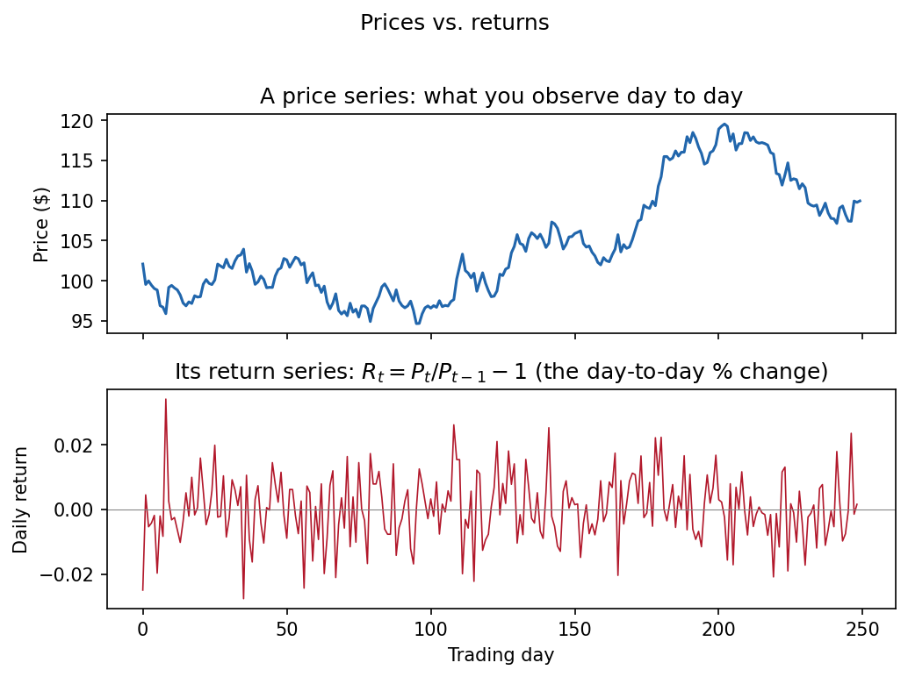
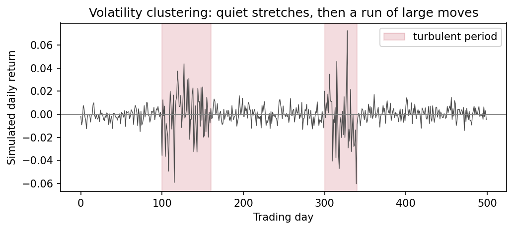
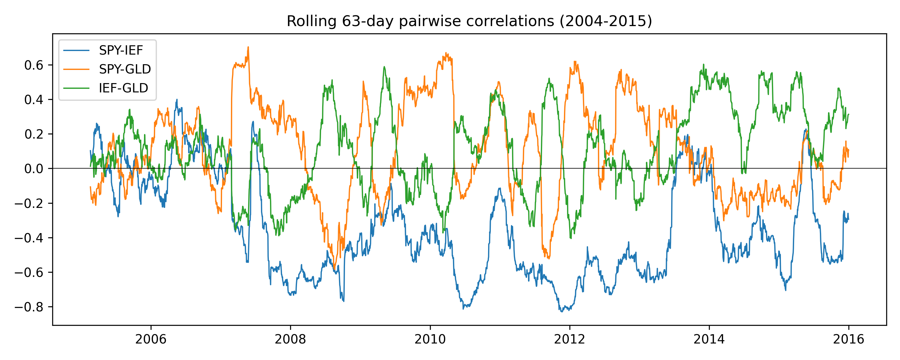
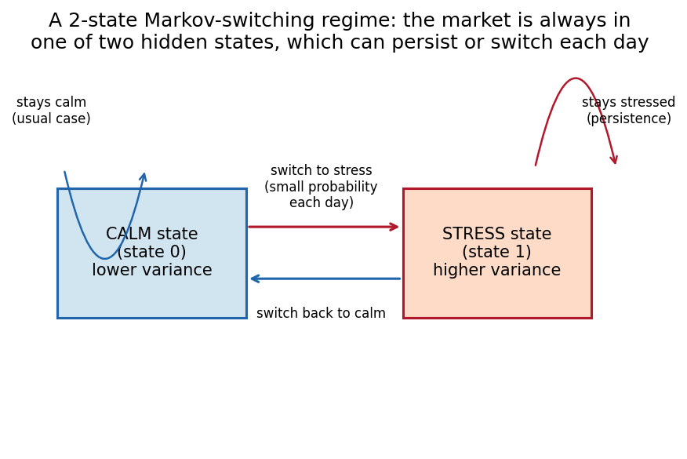
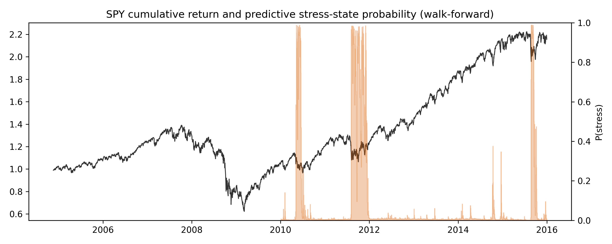
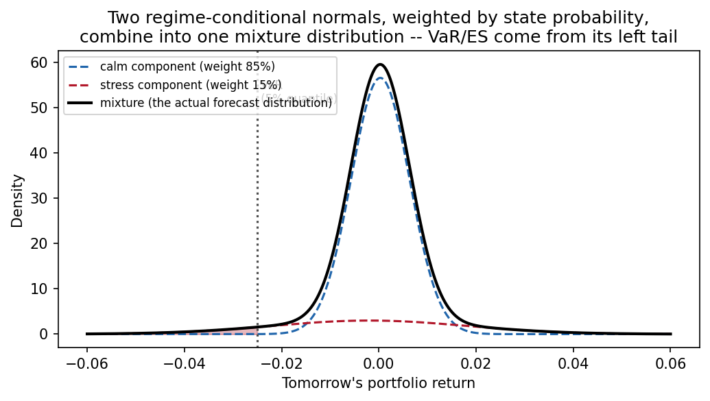
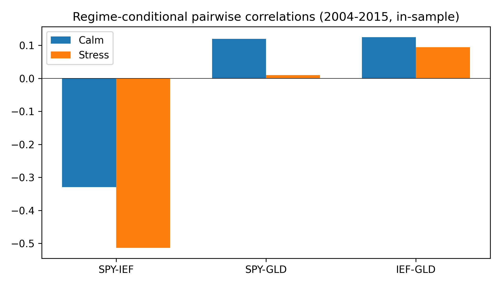
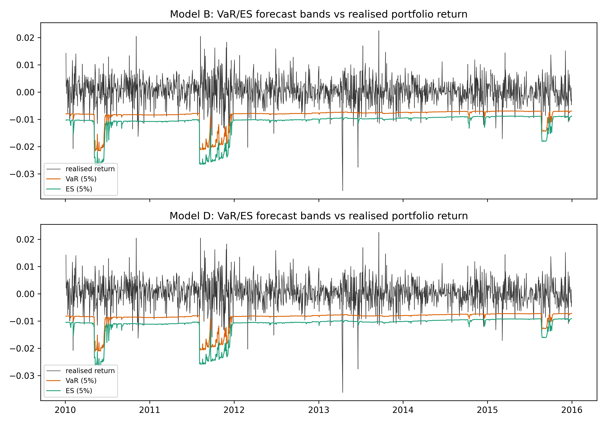
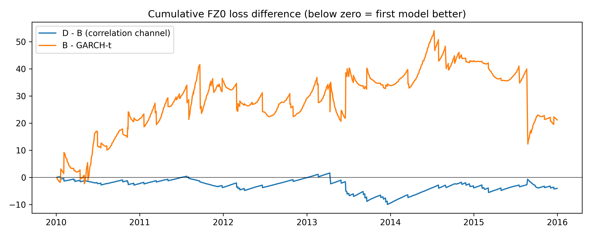
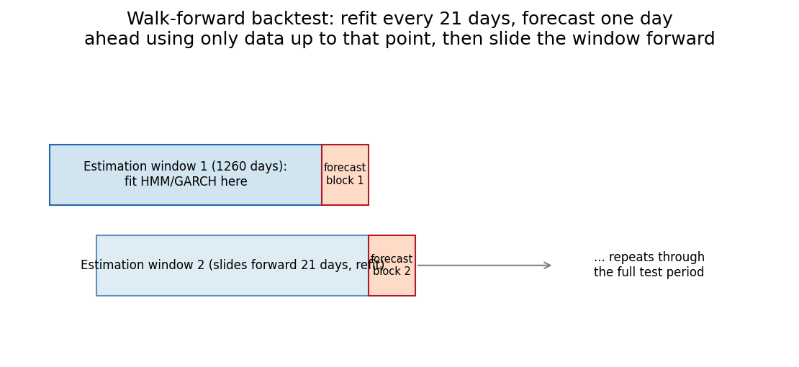

# Study Guide: Regime-Switching Risk Models for ETF Portfolios

A beginner-to-advanced walkthrough of this thesis project's foundations,
methods, and pilot study — written so each part gives you exactly what
the next part needs, ending at the actual decisions still open with
Prof. Seo.

---

## Part 1 — Foundations

### 1.1 What an ETF is, and why SPY/IEF/GLD

An ETF (Exchange-Traded Fund) is a basket of assets — like a single share
that actually represents ownership of many underlying assets — that
trades on an exchange like an ordinary stock. Instead of buying dozens of
individual bonds or a bar of gold, you buy one ETF share that tracks
their combined value.

This pilot uses three ETFs, each standing in for a different asset class:

- **SPY** tracks the S&P 500 — a proxy for US equities (stocks).
- **IEF** holds US Treasury bonds (roughly 7-10 year maturity) — a proxy
  for interest-rate-sensitive government debt.
- **GLD** holds physical gold — a proxy for a "safe haven" commodity.

These three were chosen because they represent three genuinely different
things that can react differently to the same event (a recession might
hurt SPY, help IEF, and do either to GLD), which is exactly what makes
their combination interesting to study. A **portfolio** here simply means
holding all three at once, in fixed proportions. This pilot uses an
**equal-weight** portfolio: 1/3 of the money in each of SPY, IEF, and
GLD, held fixed with no rebalancing logic. This is a deliberately simple
placeholder — `notes/decision_log.md` and `notes/pilot_eda.md` both flag
portfolio construction as one of the still-open decisions for the final
thesis, not a claim that equal-weighting is the "right" answer.

### 1.2 What financial risk means here, and what VaR and ES are

"Risk" in this project has a specific, narrow meaning: **how bad could
tomorrow's loss on this portfolio be, and how do we forecast that
*before* it happens?** This is different from asking "will the portfolio
go up or down" — it's specifically about the *size of the downside*.

Two standard tools quantify this:

- **Value-at-Risk (VaR)** answers: "what loss level will only be
  exceeded, say, 5% of the time?" If a portfolio's one-day 5% VaR is
  -2%, that means on 5% of days, tomorrow's loss is expected to be worse
  than -2% — and on the other 95% of days, it won't be. VaR is a
  *threshold*, not an average.
- **Expected Shortfall (ES)**, also called Conditional VaR, answers a
  follow-up question VaR leaves open: "given that the loss *did* exceed
  the VaR threshold, how bad was it on average?" ES is the average of
  the losses in that worst 5% tail, not just the cutoff point.

Formally, for a return *Y* and confidence level *alpha* (e.g. 5%):

```
VaR_alpha  is defined by:  P(Y <= VaR_alpha) = alpha
ES_alpha   is defined by:  E[Y | Y <= VaR_alpha]   (the average of Y in that tail)
```

Both are reported as *negative* numbers in this project's code (they are
literally the return quantile, e.g. -0.02 means "-2%"), which is why
you'll see formulas later with `v` and `e` as negative values — that
convention is deliberate and consistent throughout `src/engine.py`.

**Why two alpha levels (5% and 2.5%)?** This project reports VaR/ES at
both `alpha = 0.05` (5%, the more common academic/industry benchmark)
and `alpha = 0.025` (2.5%, closer to what real bank capital regulation
uses). Under the Basel/FRTB regulatory framework, banks are required to
hold capital based on ES (not VaR) at a 97.5% confidence level (i.e.
alpha = 2.5%), precisely because regulators decided VaR alone doesn't
capture how bad the tail losses actually get once you're past the
threshold — ES does. Reporting both alphas lets this pilot speak to both
the academic literature (which mostly uses 5%) and this regulatory
convention.

### 1.3 One-day-ahead forecasting and "no look-ahead bias"

This project only ever forecasts **one trading day ahead**: given
everything known up through today, what does tomorrow's risk look like?
This matches how VaR/ES are actually used in practice (daily risk
reporting) and matches the frequency of the data (daily prices).

The single most important rule in this entire codebase, repeated in the
README as "non-negotiable," is: **a forecast for day t+1 may only use
information available by day t.** This is called avoiding **look-ahead
bias** (also "data leakage") — the mistake of accidentally letting a
model peek at data from the future when making a forecast for the past,
which makes a model look artificially good in a backtest but would be
impossible to replicate in real time. You'll see this principle enforced
concretely later (Part 3's "filtered vs. smoothed probabilities," Part
5's `tests/test_no_lookahead.py`, and the strict `2015-12-31` data cutoff
used throughout the pilot).

**What Part 1 leaves open:** none of this says anything yet about *how*
to actually forecast VaR/ES from data, or why a portfolio's risk might
change from one day to the next. That's what Part 2 sets up.

---

## Part 2 — Time Series Building Blocks

Part 1 defined *what* we're forecasting (VaR/ES, one day ahead, using
only past data). This part covers the *raw material* — the return data
itself — and its statistical quirks, which is why a naive, unchanging
risk model turns out not to be good enough.

### 2.1 Prices vs. returns

You don't model prices directly — you model **returns**, the percentage
change from one day to the next, because prices trend upward over time
(inflation, growth) in a way that isn't itself the "risk" signal you
care about; returns strip that out and are much closer to statistically
stable over time.

- **Simple return:** `R_t = P_t / P_(t-1) - 1`
- **Log return:** `r_t = log(P_t) - log(P_(t-1))`

This project uses simple returns for the equal-weight portfolio
construction specifically (`portfolio_return_t = (1/3) SPY_t + (1/3)
IEF_t + (1/3) GLD_t`, which is only exactly correct for simple returns,
not log returns — averaging log returns would *not* equal the log return
of the equal-weight portfolio, a subtle but important distinction
verified in `tests/test_returns.py`).


*A price series climbs and dips smoothly over time; its return series
(the day-to-day % change) looks much more like noise scattered around
zero — this is the series risk models actually work with.*

### 2.2 Volatility, volatility clustering, and fat tails

**Volatility** just means "how much returns bounce around" — typically
measured as the standard deviation of returns. The critical empirical
fact motivating almost everything that follows: **volatility is not
constant over time.** This project's own exploratory analysis
(`notes/pilot_eda.md`) found the equal-weight portfolio's rolling 21-day
volatility ranged from about 0.0015 (calm periods) to about 0.022 (the
sharpest spike, around early 2020) — more than a 14x difference. Crucially,
elevated volatility "tends to persist for multiple weeks rather than
appearing as isolated single-day spikes" — this persistence pattern is
called **volatility clustering**: calm periods and turbulent periods each
tend to cluster together in time, rather than volatility jumping randomly
day to day.


*A simulated return series showing volatility clustering: mostly calm,
small movements, punctuated by stretches where large moves (in either
direction) bunch together — this is a visual sketch, not real data, but
matches the qualitative pattern found in the actual pilot returns.*

The same EDA found something equally important about the *shape* of the
return distribution: SPY's daily returns have an excess kurtosis of 12.1
(a normal/Gaussian distribution has excess kurtosis of 0 by definition).
High excess kurtosis means **fat tails** — extreme moves happen far more
often than a normal-distribution model would predict. This matters
directly for VaR/ES: if you assume returns are normally distributed when
they're actually fat-tailed, you will systematically *underestimate* how
bad the worst days can get.

One more diagnostic from the same EDA distinguishes two different kinds
of "predictability": the *level* of returns (is today's return
correlated with yesterday's?) showed weak autocorrelation, but *squared*
returns (a proxy for volatility, since squaring removes the sign) showed
much stronger, slowly-decaying autocorrelation. In plain terms: **you
can't predict the direction of tomorrow's return from past returns, but
you *can* say something about how large tomorrow's move is likely to be**,
based on how large recent moves have been. This is precisely the
empirical signature that motivates the volatility models in Part 3.

### 2.3 Correlation, covariance, and diversification

When you hold more than one asset, what matters isn't just each asset's
own volatility, but how they move *together*. **Correlation** measures
this: a value near +1 means two assets tend to rise and fall together; near
-1 means they tend to move in opposite directions; near 0 means little
linear relationship. **Covariance** is the un-normalized version of the
same idea, and a **covariance matrix** captures every pairwise
relationship among all three assets at once.

**Diversification** is the practical payoff of holding imperfectly
correlated assets: this pilot's own data shows the equal-weight
portfolio's daily standard deviation (0.0052) is *lower* than any single
asset's volatility alone (SPY: 0.0108, GLD: 0.0100) — combining assets
that don't move in lockstep smooths out the ride. The full-sample
SPY-IEF correlation was found to be -0.26 — consistent with the familiar
"stocks and bonds hedge each other" story.

But that's a single, *unconditional* number averaged over the whole
sample. The thesis's actual research question is about whether this
relationship **itself changes** during market stress — a phenomenon
sometimes called **correlation breakdown**: the idea that diversification
benefits can evaporate exactly when you need them most (typically,
assets that normally hedge each other start moving together in a
crisis). Whether this actually happens in this project's own data, and
in which direction, turns out to be a genuinely interesting and
non-obvious finding covered in Part 5.


*The pilot's own actual output: rolling 63-day pairwise correlations
among SPY/IEF/GLD, 2004-2015. Notice these lines are not flat — exactly
the "correlation isn't one fixed number" point this section is making,
shown with real data rather than an abstract claim.*

**What Part 2 leaves open:** a model that assumes one fixed volatility
number and one fixed correlation number for the entire sample — a
constant covariance matrix — cannot represent either volatility
clustering or a potential correlation breakdown. Part 3 introduces models
that let these quantities change over time.

---

## Part 3 — The Core Statistical Models

Recall from Part 2: volatility clusters over time, returns are
fat-tailed, and correlations might change during stress — a fixed
covariance matrix can't capture any of this. This part builds up, from
simplest to most complex, the models this thesis actually uses to let
volatility and correlation vary.

### 3.1 EWMA: the simplest "smooth updating" model

**Exponentially Weighted Moving Average (EWMA)** volatility is the
simplest fix to "volatility isn't constant": instead of one long-run
average variance, EWMA keeps a running estimate that updates every day,
giving more weight to recent observations:

```
variance_estimate(t) = lambda * variance_estimate(t-1) + (1 - lambda) * r(t-1)^2
```

This project uses `lambda = 0.94`, the industry-standard RiskMetrics
value (`config/pilot.yaml`'s `ewma_lambda`). Intuitively: after a big
move yesterday (`r(t-1)^2` large), today's volatility estimate rises
immediately, then gradually decays back down if calm returns — a direct,
mechanical way of capturing volatility clustering, but a *smooth* one:
there's no notion of two distinct "states," just a continuously
adjusting number. This project uses EWMA in two forms:
**univariate EWMA** (one volatility number for the whole portfolio) and
**multivariate EWMA** (`EWMA_MV`, a full covariance matrix updated the
same way — `src/engine.py`'s `mv_ewma_update`). EWMA_MV is the *smooth,
non-regime* analogue of the correlation question this thesis asks with
regimes — more on why that comparison matters in Part 4.

### 3.2 GARCH(1,1) with Student-t errors

**GARCH** (Generalized AutoRegressive Conditional Heteroskedasticity)
goes one step further than EWMA: instead of a fixed decay rate, it
*estimates* how much weight to put on yesterday's shock vs. the
longer-run average, from the data itself:

```
variance(t) = omega + alpha * shock(t-1)^2 + beta * variance(t-1)
```

(Note: this `alpha`/`beta` are GARCH's own coefficient names, unrelated
to the VaR confidence level `alpha` from Part 1 — an unfortunate but
standard naming clash in the literature.) Here `omega` is a baseline
variance level, `alpha` controls how
strongly a recent shock (`shock(t-1)^2`) raises today's volatility,
and `beta` controls how much of yesterday's volatility estimate
persists. GARCH is refit every 63 days in this pilot
(`config/pilot.yaml`'s `garch_refit`) and filtered day-by-day in between
(`src/engine.py`'s `fit_garch_t`, `t_var_es`).

**Why Student-t, not normal, errors?** Recall from Part 2: real returns
are fat-tailed (SPY's excess kurtosis of 12.1). A GARCH model with normal
(Gaussian) errors still underestimates extreme moves even after
accounting for time-varying volatility. The **Student-t distribution**
has heavier tails than the normal distribution, controlled by a "degrees
of freedom" parameter (lower = fatter tails) — using it directly
addresses the fat-tails problem identified back in Part 2, rather than
just papering over it with a bigger volatility number.

### 3.3 Hidden Markov Models and regime-switching

EWMA and GARCH both produce one continuously-adjusting volatility number.
This thesis's central idea is different: what if markets instead
alternate between a small number of discrete, qualitatively different
**regimes** — say, "calm" and "stressed" — where each regime has its own
typical volatility (and, the thesis asks, possibly its own typical
correlation pattern too)?

A **Hidden Markov Model (HMM)** is the tool for this. "Hidden" because
you never directly observe which regime the market is in — you only see
returns, and have to *infer* the regime probabilistically. "Markov"
because the model assumes the *next* regime depends only on the
*current* regime (not the whole history) — a simple memory-less
switching rule with a fixed transition probability each day.


*A 2-state Markov chain: the market is always in one of two hidden
states (calm or stressed). Each day, it either stays in its current
state or switches, according to fixed transition probabilities. This
project's stylised simulation calibration (`config/pilot.yaml`) sets a
99% chance of staying calm and a 97% chance of staying stressed each
day — both states are "sticky," but stress is somewhat less sticky than
calm.*

This project fits a **2-state Gaussian HMM** (`src/engine.py`'s
`fit_hmm`) on SPY's returns only (not the whole portfolio — a design
choice examined critically in Part 5 and Part 7). The two states are
ordered by variance (state 0 = calm, lower variance; state 1 = stress,
higher variance). Rather than assigning each day a hard "calm" or
"stress" label, the HMM produces a *probability* of being in each state
on each day — this is what lets the risk models blend regime-conditional
moments smoothly rather than jumping abruptly.

**Filtered vs. smoothed probabilities, and why this matters for Part 1's
no-look-ahead rule:** given the whole return history, you could compute
a regime probability for day t using data both *before and after* t
("smoothed" probabilities) — but that would violate the no-look-ahead
principle from Part 1, since forecasting day t+1 with information from
day t+5 is exactly the kind of leakage this project forbids. Instead,
this project only ever uses **filtered** probabilities: the regime
probability for day t computed using *only* data up through day t
(`src/engine.py`'s `filtered_probs`), and specifically the **one-step
predictive** probability for forecasting day t+1 given data through day
t. This is a direct, concrete instance of Part 1's rule being enforced in
the actual model code.


*The pilot's own actual output: SPY's cumulative return alongside the
HMM's predictive stress-state probability, walk-forward, 2010-2015. Spikes
in the stress probability line up with real market stress episodes —
this is the concrete, real-data version of the state diagram above,
showing the filtered probability actually moving between near-0 (calm)
and near-1 (stress) over time.*

**Warm-starting:** each time the HMM is refit (every 21 trading days,
`config/pilot.yaml`'s `refit`), rather than starting the estimation from
scratch, it initializes from the *previous* refit's fitted parameters
(`fit_hmm`'s `prev` argument) — a practical choice that keeps the
regime-labeling consistent across refits (so "state 1" continues to mean
"stress" rather than randomly flipping labels) and speeds up
convergence.

### 3.4 Mixture distributions: connecting regimes back to VaR/ES

Part 1 defined VaR/ES from a *single* predictive distribution of
tomorrow's return. An HMM instead gives you *two* possible
distributions (one per regime) plus a probability of being in each. The
way these combine is a **mixture distribution**: the overall predictive
distribution for tomorrow is a probability-weighted blend of the two
regime-conditional normal distributions.


*Two regime-conditional normal distributions (calm: narrow, centered near
zero; stress: wider, slightly negative-mean) combine, weighted by their
respective state probabilities, into one mixture distribution (solid
black curve). VaR and ES for the whole portfolio come from the left tail
of this combined mixture, not from either component alone.*

Formally (`src/engine.py`'s `mix_var_es`), VaR is found by solving for
the quantile `q` where the mixture's cumulative probability equals
`alpha`:

```
sum over each regime k of:  p_k * NormalCDF((q - mu_k) / sigma_k)   =   alpha
```

and ES is then computed in closed form from that same mixture. This
closes the loop back to Part 1: the regime machinery from this part
exists entirely to produce the input (a predictive distribution) that
Part 1's VaR/ES definitions need.

**What Part 3 leaves open:** now that we have EWMA, GARCH-t, and
regime-switching HMMs as three different ways of letting risk change
over time, Part 4 explains precisely how this thesis compares them
against each other to answer its actual research question.

---

## Part 4 — The Specific Research Design

Part 3 gave you three families of tools (EWMA, GARCH, HMM regimes). This
part explains exactly how they're assembled into the thesis's actual
experiment, and why.

### 4.1 The A/B/C/D covariance-variant ablation

The central design trick is an **ablation**: build four versions of
essentially the same regime-aware model, each one letting a *different
combination* of volatility and correlation vary by regime, while holding
everything else identical (same HMM, same regime probabilities, same
estimation window). This isolates exactly which ingredient — volatility
regime-dependence, correlation regime-dependence, or both — is doing the
forecasting work.


*Each of the four variants sits in one cell of a 2x2 grid: does
volatility vary by regime (columns), and does correlation vary by regime
(rows)? A is the "no regime information used at all" baseline; D uses
regime information for both.*

Concretely, using the regime probabilities from Part 3
(`src/engine.py`'s `build_variants`):

- **A** — pooled covariance: a single covariance matrix for the whole
  sample, ignoring the regime entirely (the "no regime" baseline).
- **B** — regime-dependent *volatilities*, but a single *pooled*
  correlation matrix shared by both regimes.
- **C** — a single pooled volatility, but regime-dependent
  *correlations*.
- **D** — both volatilities and correlations vary by regime.

**Why D vs. B is the thesis's primary test:** B already lets volatility
change by regime — so if D (which adds regime-dependent correlation on
top of B) forecasts meaningfully better than B, that improvement can only
be coming from letting *correlation* vary by regime, since everything
else about D and B is identical. This is precisely how you isolate "does
correlation-regime-switching add value beyond volatility-regime-switching
alone" — the plain-English version of the thesis question stated back in
the project's README, now precise enough to test.


*The pilot's own actual output: pairwise correlations computed separately
within the calm regime vs. the stress regime, 2004-2015 in-sample. This
is precisely variant C/D's regime-conditional correlation matrices from
the grid above, but on real data rather than notation — compare how much
(or little) each pair's correlation actually differs between the two
bars.*

### 4.2 Benchmarks

Alongside A/B/C/D, four independent benchmark models provide outside
points of comparison, each introduced in Part 3:

- **HS (historical simulation)** — the simplest possible approach: just
  take the worst 5% (or 2.5%) of the last 500 days' actual returns as the
  VaR/ES estimate. No model at all, just empirical history.
- **EWMA** and **EWMA_MV** — the smooth, non-regime volatility model from
  §3.1. Comparing B/D against **EWMA_MV** specifically tests whether
  discrete regime-switching beats a smoothly-updating alternative that
  achieves something similar without ever assuming there are exactly two
  states.
- **GARCH-t** — the estimated, fat-tailed volatility model from §3.2.
  Comparing B/D against GARCH-t tests whether the discrete-regime
  volatility story adds anything beyond a well-specified single-regime
  model that already adapts its volatility continuously.

### 4.3 The evaluation framework: how do you know a forecast is actually better?

Recall from Part 1 that VaR/ES are just numbers — but you need a
principled way to say "model D's forecasts were *better* than model B's"
rather than eyeballing two numbers. Three tools do this:

**The FZ0 loss function** (Fissler-Ziegel/Patton-Ziegel-Chen 2019,
`src/engine.py`'s `fz0`) gives every day's (VaR, ES) forecast pair a
single loss score, designed so that a forecaster who reports their *true*
beliefs about tomorrow's distribution gets the lowest expected loss (a
property called "consistency" or being "elicitable jointly" for VaR and
ES together — you don't need the exact math to understand the intuition:
it's a scoring rule built specifically so that gaming it doesn't pay off,
and it penalizes both a VaR breach and a badly-calibrated ES).

**Why you need a formal statistical test, not just comparing two loss
numbers:** if model D's average loss over the backtest period is
slightly lower than model B's, is that a real, reliable difference, or
could it easily have happened by chance given the limited number of test
days? **The Diebold-Mariano (DM) test** (`src/engine.py`'s `dm_test`)
answers exactly this: it takes the day-by-day loss *difference* between
two models and tests whether its average is statistically distinguishable
from zero, accounting for the fact that forecast errors on nearby days
are correlated (via a Newey-West "HAC" adjustment). A negative DM
t-statistic means the first model had lower average loss; a very
negative one (beyond the standard significance thresholds) means that
difference is unlikely to be chance.

**Kupiec and Christoffersen tests** check something different again: not
"is one model's loss lower than another's," but "is *this* model's VaR
correctly calibrated on its own terms?" If your 5% VaR is well-specified,
exactly around 5% of days should actually breach it (a "hit"). The
**Kupiec test** (`src/engine.py`'s `kupiec`) checks whether the *overall
hit rate* matches the target alpha. The **Christoffersen test**
(`christoffersen_ind`) checks something Kupiec can miss: whether hits
cluster together in time (e.g. all 10 breaches happening in the same
crisis week) rather than being spread out independently — clustered
breaches suggest the model is slow to react to a real regime shift, even
if its long-run average hit rate looks fine.


*The pilot's own actual output: a model's VaR/ES forecast bands plotted
against the realised portfolio return, day by day. A "hit" (Kupiec/
Christoffersen's subject) is any day the realised return falls below the
VaR line — this is what that actually looks like on real data, rather
than as an abstract 0/1 sequence.*


*The pilot's own actual output: the running cumulative sum of D's FZ0
loss minus B's, day by day, 2010-2015. A line trending below zero means D
has been out-forecasting B up to that point; trending above zero means
the opposite. The DM test (§4.3) is essentially asking whether this
line's overall downward or upward drift is statistically real or just
noise.*

**What Part 4 leaves open:** we now have the full design (A/B/C/D,
benchmarks, and how to score them) — but does this design actually have
the statistical *power* to detect a real correlation effect if one
exists, given a realistic amount of data? That's exactly what the pilot
study (Part 5) exists to check before trusting any real-data result.

---

## Part 5 — The Pilot Study Workflow, Step by Step

Part 4 gave you the full design. This part walks through how it was
actually tested in five work packages (WP0-WP5), each one existing
because of a specific gap the previous one left open.

### WP0 — Data acquisition and audit

**Purpose:** before any modelling, make sure the raw data is trustworthy
and reproducible. WP0 downloaded SPY/IEF/GLD adjusted prices once from
Yahoo Finance, archived an immutable raw snapshot with a SHA-256
provenance hash (`data/raw/MANIFEST.txt`), and ran an audit checking for
missing dates, zero/duplicate prices, extreme (8-sigma) returns, and
dividend-adjustment consistency (`src/audit.py`). **Why this has to come
first:** every later result is only as trustworthy as the data
underneath it — an audit is cheap to do once and expensive to have
skipped if a data error later turns out to explain a "finding."

### WP1 — Correctness test suite

**Purpose:** before trusting *any* number the engine produces, verify the
engine's mathematical building blocks (Part 3-4's mixture VaR/ES
root-finding, the FZ0 loss, the DM test, the no-look-ahead property) are
actually implemented correctly — 41 tests in `tests/`, covering things
like: does `mix_var_es` reduce to the correct closed form under known
inputs, does the walk-forward loop genuinely never let a forecast see
future data (`tests/test_no_lookahead.py`), does the HMM recover known
synthetic regime parameters (`tests/test_hmm_recovery.py`). **Why this
comes before any simulation or real-data result:** a bug in the scoring
code could silently manufacture a "finding" that isn't real. All 41 tests
pass.

### WP2 — Simulation power study

**Purpose:** this is the step that makes WP3's real-data result
interpretable at all. Before trusting any answer from real market data,
you need to know: **if the correlation effect genuinely existed, would
this design's sample size and test even be able to detect it?** WP2
answers this by simulating fake data from a known "data-generating
process" (DGP) — a 2-state Markov-switching model (`src/dgp.py`) where
the *true* correlation-breakdown effect size is set by the researcher, not
estimated — and checking how often the D-vs-B test correctly detects it.

Four scenarios test different true effect sizes (from `config/pilot.yaml`):
**S0** (vol-only, no correlation change — a null case that should *not*
trigger a false positive), **S1** (moderate correlation breakdown),
**S2** (strong breakdown), and **S3** (a "flight to quality" scenario
where correlations move in the diversifying direction, testing that the
design doesn't confuse this with a breakdown). Each scenario was run
under two independent DGP calibrations ("stylised" hand-set parameters,
and "calibrated" parameters estimated from this project's own real
2004-2015 data) at both alpha levels, 200 and 100 replications
respectively.

**What was found:** the design's false-positive rate in S0 is
essentially exact (5.0% at nominal 5%, under the stylised DGP) — the test
is well-calibrated, not prone to crying wolf. Detection power rises with
effect size as expected: only 25.5% in the moderate-breakdown scenario
(S1) even with 10 years of data, but 52.5% in the strong-breakdown
scenario (S2). This tells you something important *before* even looking
at real data: **this design can reliably detect only a large correlation
regime shift, not a subtle one**, with a realistic amount of daily data.

Because the simulation's true regime and true covariances are known
exactly (they were set by the researcher, not estimated), WP2 also scores
two extra "oracle" models — **Oracle_B** and **Oracle_D** — which use the
*true* regime probabilities and *true* covariances directly, rather than
ones estimated by the HMM. These aren't candidates for the real thesis
(you can never know the true regime in real data); they exist purely to
separate two different sources of imperfect detection: is a weak result
due to the *estimation* being noisy (HMM-estimated B/D underperforming
their oracle counterparts), or is it inherent to the *effect size itself*
(even Oracle_D struggling to beat Oracle_B)? This distinction matters for
interpreting exactly how much of WP2's power limitation (§ above) is a
fixable estimation problem versus a fundamental one.


*The pilot's own actual output: how detection power for the moderate-
breakdown scenario changes as the test period lengthens from 5 to 15
years. Power rises with more data, as you'd expect, but only slowly —
even at 15 years it doesn't reach the 50% mark this design would need to
call a moderate effect reliably detectable.*

### WP3 — Real-data pilot (2010-2015)

**Purpose:** now, with WP2 establishing what this design *can* detect,
apply it to real market history — but only on a locked-safe validation
window (2010-2015), strictly excluding the actual thesis test period
(2016-2025) to avoid any risk of the pilot's exploratory choices
"peeking" at data the final thesis will later be evaluated on
(`tests/test_locked_period.py` enforces this in code, not just in
intent).


*How the backtest actually moves through time: fit on a 1260-day
estimation window, forecast the next 21-day block one day at a time
(never using data from inside that block itself), then slide the whole
window forward by 21 days and repeat — this is the concrete mechanism
enforcing Part 1's no-look-ahead rule throughout Part 3's models.*

WP3 covers: **descriptive regime statistics** (in-sample HMM fit,
regime-conditional volatilities/correlations, and a Shapley-style
attribution of how much of the calm-to-stress increase in portfolio
volatility comes from the volatility channel vs. the correlation
channel); the **walk-forward backtest** itself (Part 3's rolling-window,
Part 4's A/B/C/D-vs-benchmarks comparison, actually run on real returns);
**stability diagnostics** (does the HMM keep finding a sensible,
persistent regime across 72 monthly refits, or does it sometimes
collapse/flip?); and **three named-episode diagnostics** (2011 US
downgrade, 2013 taper tantrum, 2015 August selloff) — specific, real
historical stress events checked individually.

**What was found, and why WP2 makes it interpretable:** the real-data
D-vs-B test came back statistically null (DM t=-0.469, p=0.639) — no
significant difference. Without WP2, this would be genuinely ambiguous:
does it mean correlation regimes don't matter, or does it mean the
effect is real but this window's data just isn't extreme enough to
detect it (as WP2 already showed happens for moderate effects even with
10 years of data)? The descriptive attribution answers this directly: in
this specific 2010-2015 window, the correlation channel's contribution to
the stress-period volatility increase was actually *negative* (-13.1%) —
equity-bond correlation moved from -0.33 (calm) to -0.51 (stress), i.e.
*more* diversifying under stress, not less. **There was no correlation
breakdown in this window at all** — so the null result is exactly what
WP2's own S0/S3-type scenarios would predict, not evidence the design is
broken.

The 2013 taper tantrum episode is a striking, concrete finding: this
was a real bond/rates-driven shock, but the equity-only HMM regime signal
(recall from Part 3 that the HMM is fit on SPY returns only) showed
essentially zero stress probability (mean 0.7%) throughout it. This is a
direct, real-world instance of the design choice flagged back in Part 3
— an equity-based regime signal can be blind to a non-equity-driven
shock.

### WP4 — Reproducibility check

**Purpose:** a result that can't be reproduced isn't a result. WP4 reran
WP1's test suite, reran WP3's entire pipeline from scratch and diffed it
numerically against the committed tables (found identical), recomputed a
subset of WP2's simulation replications directly and compared them
bit-for-bit against the checkpointed values (found identical), and reran
a reduced batch of WP2 under an entirely different random seed to check
the *conclusions* (not exact numbers) still hold up. All checks passed —
notably, this reproducibility check itself caught and fixed a real bug
during the pilot (a checkpoint file was accidentally being reused across
different random seeds, silently making the different-seed check a
no-op) — a concrete demonstration of why this step exists at all rather
than just trusting the code once.

### WP5 — Literature positioning

**Purpose:** connect the pilot's own numbers to the actual academic
disagreement motivating the thesis, covered next in Part 6.

**What Part 5 leaves open:** the pilot produced real numbers on both
sides of an open academic debate — Part 6 explains what that debate
actually is and exactly how these numbers relate to it.

---

## Part 6 — Where the Literature Fits

Recall from Part 2 that this thesis's question — does letting correlation
vary by regime improve risk forecasts beyond letting only volatility vary
— is testing something genuinely unresolved in prior research (this is
why a pilot study, rather than just running the full thesis directly, was
worth doing at all).

**The core disagreement:** Santos, Nogales & Ruiz (2013) found
multivariate (correlation-aware) models beat univariate ones for
portfolio VaR — evidence that changing correlation *does* add value.
Fortin, Simonato & Dionne (2023), using a very similar joint VaR/ES
scoring approach to this thesis, found *no* statistically significant
difference between univariate and multivariate approaches for one-week
ES forecasts — evidence that it *doesn't* matter much in practice.

**Where this pilot's own results land:** WP2's simulation (Part 5) shows
the correlation channel genuinely *can* be detected — 52.5% power in the
strong-breakdown scenario — which supports Santos et al.'s camp, *given a
strong enough regime shift*. But WP3's real-data result on 2010-2015 came
back null, landing in Fortin et al.'s camp — and the descriptive
attribution explains *why*: this window simply didn't contain a
correlation breakdown (recall Part 5's finding that the correlation
share of the stress-vol increase was -13.1%, i.e. slightly diversifying).
Fortin et al. partly attribute their own null to data frequency
(weekly vs. daily); this pilot's null adds a second, complementary
explanation — a null can also be a property of *which regime a
particular historical sample happens to contain*, not just of frequency.

**Paolella, Polak & Walker (2019)** is the closest published relative —
Markov-switching correlation dynamics for tail-risk forecasting — but
their model bundles volatility and correlation together rather than
separating them the way this thesis's A/B/C/D design does. The pilot's
transparent, weaker-but-interpretable version of their question (power
capping around 50% even in the strongest simulated scenario, real-data
null on this window) suggests their strong headline result may depend on
a longer/more volatile sample or a different, more breakdown-prone asset
universe than SPY/IEF/GLD.

**Ardia, Bluteau, Boudt et al. (2018)** found regime-switching GARCH
doesn't uniformly beat single-regime GARCH across assets and periods.
This pilot's own univariate regime-volatility comparison (B/D vs.
GARCH-t, from Part 4's benchmark set) reproduces exactly this pattern:
even inside the simulation, where the true DGP genuinely *is* a
two-regime process, power for the regime model to beat GARCH-t is only
31.5% in the vol-only scenario and falls to 6.0% in the strong-breakdown
scenario — and on real data, neither regime variant significantly beats
GARCH-t (p=0.66, p=0.72).

**Kinlaw, Kritzman, Page et al. (2021)** caution that naive
crisis-correlation measures can overstate how much dependence actually
changes in a crisis, and that what matters is measured through
forecasting rather than raw correlation comparisons — exactly the
approach this thesis takes (via the D-vs-B forecast-accuracy test rather
than just comparing crisis-period correlation numbers directly). The
pilot's own real-data finding — equity-bond correlation moving *more*
negative, not less, in stress — is a concrete instance of the naive
"stocks and bonds correlate more in a crisis" story failing to hold, and
is exactly the kind of surprise their caution predicts you might find.

**What Part 6 leaves open:** given all of this, was the pilot's overall
verdict to proceed with the full thesis design, or change course? Part 7
covers the actual decision and what's still unresolved.

---

## Part 7 — Where Things Stand, and What to Discuss with Prof. Seo

### 7.1 The go/no-go verdict

Before running WP2/WP3, six criteria (G1-G6) were pre-registered in
`docs/preregistration.md`, specifically so the decision of whether to
proceed couldn't be quietly adjusted after seeing convenient or
inconvenient results. Each tests a concept from earlier in this guide:

- **G1 (pipeline correctness)** tests Part 5's WP1 correctness suite:
  PASS, 41/41 tests.
- **G2 (test size)** tests whether Part 4's DM test, applied to Part
  5's WP2 S0 null scenario, has a false-positive rate at or below 10%:
  PASS (5.0% stylised, 2.0% calibrated).
- **G3 (detectability)** tests whether Part 4's DM test, applied to Part
  5's WP2 breakdown scenarios, reaches at least 50% power with 10 years
  of data: PASS under the primary (stylised) DGP (S2: 52.5%), but *not*
  under the secondary calibrated DGP (S2: 42.0%) — a marginal pass,
  reported honestly rather than smoothed over.
- **G4 (regime stability)** tests whether Part 3's HMM, refit repeatedly
  on real data (Part 5's WP3 stability diagnostics), reliably finds a
  persistent stress state: PASS, but only just — 90.3% of 72 refits met
  the joint criterion (expected duration >=5 days, stress share 10-40%,
  no large jump), against a 90% bar.
- **G5 (reproducibility)** tests Part 5's WP4 checks: PASS, all reruns
  identical or within tolerance.
- **G6 (feasibility)** tests whether the full 2016-2025 thesis run would
  finish in a practical time: PASS, extrapolated at roughly 43 seconds
  (measured ~26 seconds for the 2010-2015 window, scaled up), far under
  the 2-hour ceiling.

**All six criteria pass, so the pre-registered decision rule is:
PROCEED with the full design.** G3 and G4's marginal passes are carried
forward honestly as limitations rather than treated as clean successes —
see `output/PILOT_REPORT.md` for the full scorecard and discussion.

### 7.2 What's still open, and why it needs Prof. Seo specifically

These are genuinely judgment calls, not things resolvable by reading more
(from `notes/decision_log.md` and `notes/supervisor_questions.md`):

- **Final ETF universe and portfolio construction** — Part 1 covered why
  SPY/IEF/GLD equal-weight is a placeholder; the final choice is a
  research-design decision about what the thesis should generalize to.
- **Two vs. three regimes** — Part 3 covered the 2-state HMM; WP3's real
  stress durations (45-97 days, Part 5) are far longer than the 5-day
  floor, raising the question of whether a third state could usefully
  separate "moderate" from "acute" stress. This requires judgment about
  identifiability and interpretability that goes beyond what the pilot
  alone can settle.
- **Regime-identifying variable** — Part 3/5 covered the equity-only HMM
  signal's blind spot during the 2013 taper tantrum. Whether to add a
  second variable (rates, VIX) is a modelling-philosophy choice with
  tradeoffs (simplicity vs. capturing non-equity shocks) that benefits
  from a supervisor's field experience.
- **The G3 power caveat** — Part 4's evaluation framework and Part 5's
  WP2 results show this design only reliably detects a *strong*
  correlation shift. Whether that's an acceptable limitation to report,
  or whether the full thesis needs the REFRAME fallback already specified
  in `docs/preregistration.md` (a power-aware attribution study instead),
  is a call about what the thesis is ultimately trying to claim.
- **Benchmark model set, VaR/ES evaluation design, dependence-testing
  method, portfolio-allocation extension** — still open per the README's
  "Current Open Methodological Decisions" list; not yet addressed by the
  pilot at all.

---

## Glossary

*(in the order each term was introduced)*

- **ETF** (1.1) — a fund that trades like a stock, holding a basket of
  underlying assets.
- **Equal-weight portfolio** (1.1) — holding a fixed, equal proportion of
  each asset, no rebalancing.
- **VaR (Value-at-Risk)** (1.2) — the loss threshold exceeded only
  `alpha`% of the time.
- **ES (Expected Shortfall)** (1.2) — the average loss, given that VaR was
  exceeded.
- **Alpha (confidence level)** (1.2) — the tail probability defining VaR/ES
  (e.g. 5% or 2.5%).
- **Basel/FRTB** (1.2) — the bank capital regulation framework that
  specifically requires ES-based risk measurement.
- **Look-ahead bias / data leakage** (1.3) — accidentally using future
  information in a forecast for the past.
- **Simple return / log return** (2.1) — two ways to express the
  day-to-day percentage change in price.
- **Volatility** (2.2) — how much returns fluctuate; typically the return
  standard deviation.
- **Volatility clustering** (2.2) — the tendency for high- or
  low-volatility periods to persist rather than jump randomly.
- **Fat tails / excess kurtosis** (2.2) — extreme moves occurring more
  often than a normal distribution predicts.
- **Correlation / covariance** (2.3) — how strongly, and in which
  direction, two assets' returns move together.
- **Diversification** (2.3) — the risk-reduction benefit of holding
  imperfectly correlated assets.
- **Correlation breakdown** (2.3) — the idea that correlations may rise
  (diversification may fail) specifically during market stress.
- **EWMA** (3.1) — a smoothly-updating volatility estimate, weighting
  recent observations more heavily.
- **GARCH(1,1)** (3.2) — a volatility model that estimates, from data, how
  much weight to give recent shocks vs. long-run variance.
- **Student-t distribution** (3.2) — a fat-tailed alternative to the
  normal distribution, used for GARCH errors.
- **Hidden Markov Model (HMM)** (3.3) — a model with unobserved discrete
  states (regimes) that switch according to fixed probabilities.
- **Regime** (3.3) — a hidden, qualitatively distinct market state (e.g.
  calm vs. stressed).
- **Filtered vs. smoothed probabilities** (3.3) — regime probabilities
  using only past data (filtered, look-ahead-safe) vs. the whole history
  including the future (smoothed, not used here).
- **Warm-starting** (3.3) — initializing a new model fit from the
  previous fit's parameters.
- **Mixture distribution** (3.4) — a probability-weighted blend of two
  regime-conditional distributions.
- **A/B/C/D ablation** (4.1) — the four covariance variants isolating
  whether volatility and/or correlation vary by regime.
- **Historical simulation (HS)** (4.2) — using recent actual returns
  directly as the VaR/ES estimate, with no model.
- **FZ0 loss** (4.3) — a scoring rule for joint VaR/ES forecasts that
  rewards truthful forecasting.
- **Diebold-Mariano (DM) test** (4.3) — a statistical test comparing two
  forecasters' average loss.
- **Kupiec test** (4.3) — tests whether a model's overall VaR hit rate
  matches its target alpha.
- **Christoffersen test** (4.3) — tests whether VaR hits cluster in time
  rather than occurring independently.
- **Data-generating process (DGP)** (5, WP2) — a simulation model with a
  known, researcher-set "true" effect, used to test detection power.
- **Statistical power** (5, WP2) — the probability a test correctly
  detects a real effect, given it exists.
- **Pre-registration** (7.1) — committing to decision criteria before
  seeing results, to prevent post-hoc rationalization.

---

## Appendix: Complete File Map

Every file under `src/`, `scripts/`, `config/`, `docs/`,
`output/tables/`, and `output/figures/`, and where it fits into this
guide. Most are already discussed above by name; this closes the gap for
the handful that were only covered conceptually.

**`src/`** — the model engine and pipeline code.
- `config.py` — loads `config/pilot.yaml` (§ all parameters cited
  throughout this guide, e.g. `ewma_lambda`, `refit`, come from here).
- `data.py` — data acquisition/validation/preprocessing utilities (WP0,
  Part 5); enforces the "raw data preserved unchanged" rule underlying
  the reproducibility discussion in Part 5's WP4.
- `returns.py` — the return-calculation functions from §2.1 (simple vs.
  log returns, portfolio-return construction).
- `audit.py` — the WP0 data audit (Part 5).
- `engine.py` — the model engine: HMM (§3.3), mixture VaR/ES (§3.4),
  A/B/C/D (§4.1), FZ0/DM/Kupiec/Christoffersen (§4.3), the walk-forward
  loop (Part 4-5).
- `dgp.py` — the WP2 simulation's data-generating process (§5, WP2):
  the 2-state Markov-switching multivariate-t model, its "stylised" and
  "calibrated" parameterizations, and the S0-S3 scenarios.
- `wp2_simulation.py` — runs and aggregates WP2's replications (§5, WP2).
- `wp3_real_data.py` — the real-data descriptive stats, walk-forward
  backtest, stability diagnostics, and episode diagnostics (§5, WP3).
- `run_pilot.py` — the `python -m src.run_pilot` entry point (WP0).

**`scripts/`** — the runnable pipeline steps.
- `00_download_wp0_pilot_data.py` — WP0's acquisition/audit (Part 5).
- `01_download_raw_data.py`, `02_validate_and_build_processed_data.py`,
  `03_run_eda.py` — the separate, earlier Day-1 EDA pipeline (the source
  of the §2.2 volatility-clustering and fat-tails numbers from
  `notes/pilot_eda.md`); deliberately kept independent from the pilot
  study proper (see `docs/decisions_log.md`).
- `wp2_run_simulation.py`, `wp3_run_real_data_pilot.py`,
  `wp4_reproducibility_check.py` — run WP2, WP3, and WP4 respectively
  (Part 5).
- `generate_pilot_report.py`, `export_pilot_report_pdf.py` — produce
  `output/PILOT_REPORT.md`/`.pdf` (§7.1) from the tables below.
- `make_study_guide_diagrams.py` — generates this guide's six
  illustrative (non-pilot-data) diagrams.

**`config/pilot.yaml`** — the single source of every parameter named in
this guide (window/refit lengths, alpha levels, EWMA lambda, the WP2
scenario definitions, etc.) — cited throughout Parts 3-5.

**`docs/`**
- `PILOT_PROMPT.md` — the full pilot specification this entire guide
  explains in plain language.
- `literature_briefing.md` — the source for Part 6's literature
  discussion.
- `preregistration.md` — the G1-G6 criteria and decision rules discussed
  in §7.1.
- `decisions_log.md` — the pragmatic execution choices made while
  running the pilot (e.g. why the Day-1 EDA and pilot-study pipelines
  are kept separate, referenced above).

**`output/tables/`** — every number quoted in Parts 5-7 traces to one of
these: `wp2_summary.json` (§5 WP2, §7.1 G2/G3), `wp3_descriptive.json`
(§5 WP3's regime statistics and Shapley attribution, §6),
`wp3_walk_forward.json` (§5 WP3's D-vs-B and benchmark results, the
fig4/fig6 figures), `wp3_stability.json` (§5 WP3 stability, §7.1 G4),
`wp3_episodes.json` (§5 WP3's taper-tantrum finding), and
`wp4_reproducibility.json` (§5 WP4, §7.1 G5).

**`output/figures/`** — `fig1_regimes.png` through `fig6_var_es_bands.png`
are all embedded above at the point each one's underlying concept is
introduced; `study_guide/` holds this guide's own illustrative diagrams.

---
*This guide is a companion to `output/PILOT_REPORT.md` (the pilot's
formal results) and `output/literature_positioning.md` (the literature
mapping). Figures fig1-fig6 are the pilot's own real output
(`output/figures/`); the six diagrams above are illustrative sketches
generated by `scripts/make_study_guide_diagrams.py`.*
