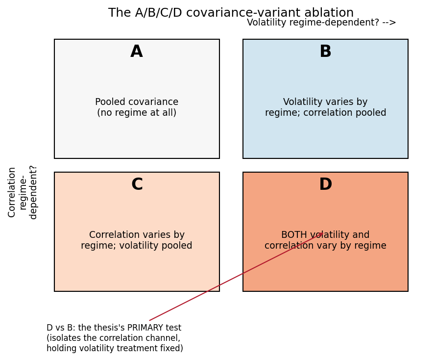
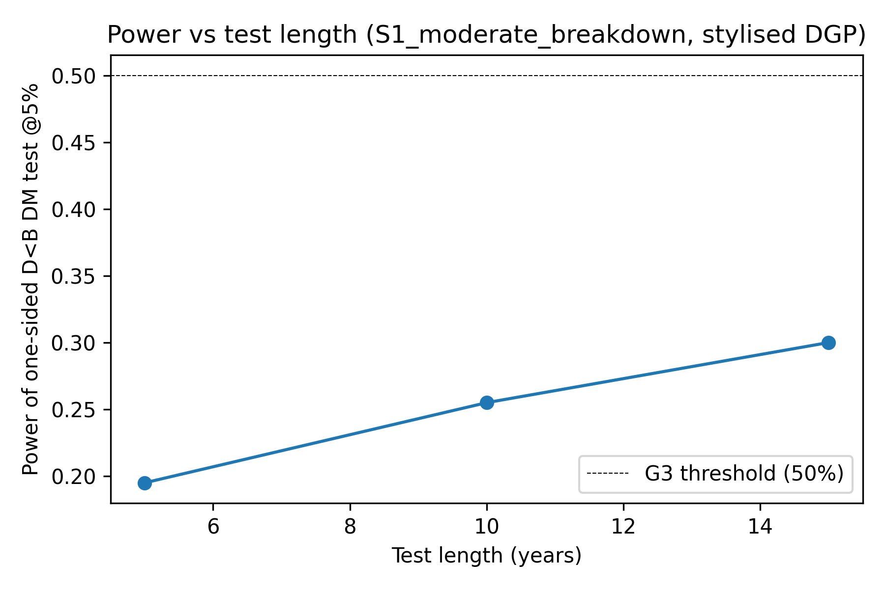
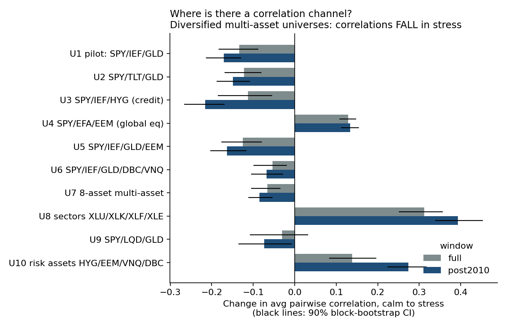
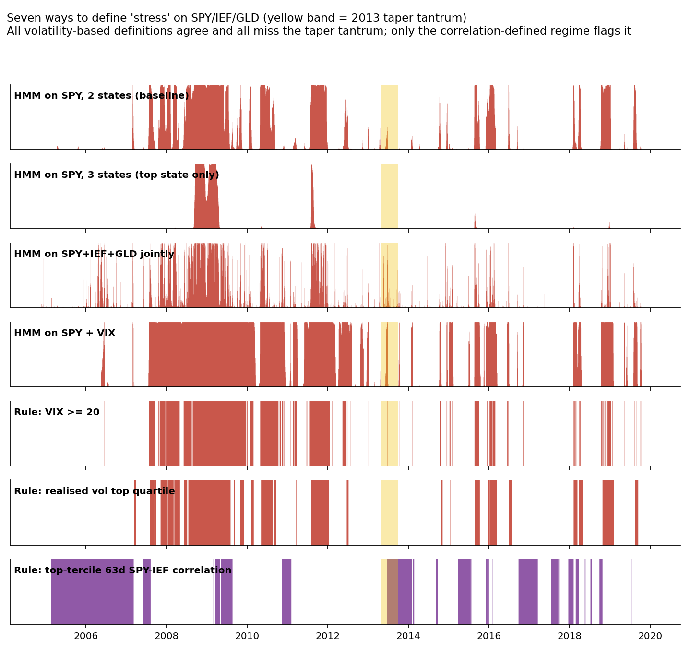
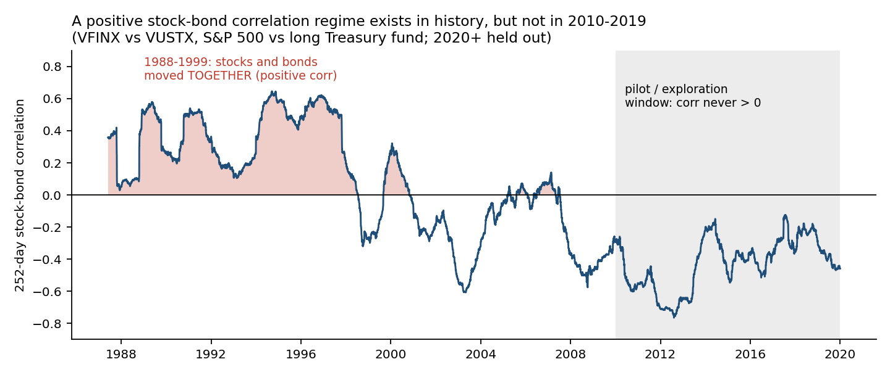
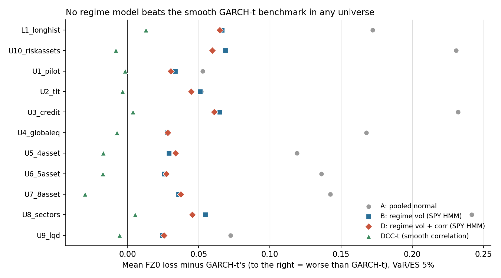
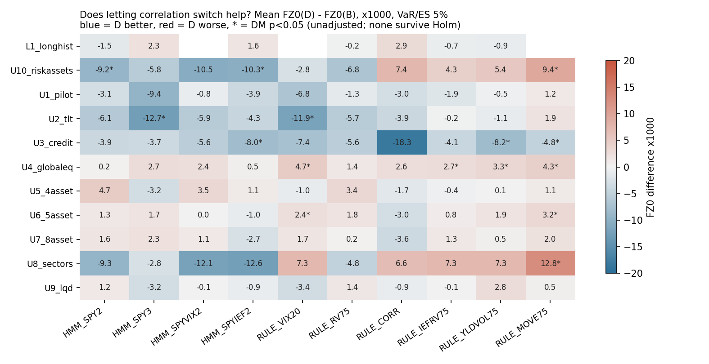

# Supervisor Meeting Brief: Where the Thesis Stands and What to Decide

**Regime-Switching Risk Models for ETF Portfolios**
Prepared for Prof. Seo. All results use data through 2019-12-31 only; 2020-2025 has not been looked at.

## 1. Bottom line (read this first)

1. **The pilot said "proceed", and it was right to check first.** All six pre-registered go/no-go criteria passed. The pilot also showed the test is weak: with about 10 years of daily data it detects only a *strong* correlation shift (about 50% power), and a moderate one only about 25% of the time.
2. **Broad exploration (as you asked) found no evidence that regime-switching *correlations* improve risk forecasts.** Across 10 ETF universes, 10 ways to define a regime, and a 28-year stock/bond sample, letting correlations switch gave no detectable gain over letting only volatilities switch (0 of 214 tests significant after correction).
3. **Regime models also lose to simple smooth models.** No regime model we tried beat GARCH-t or DCC-GARCH on tail-risk forecasts (0 of 214 comparisons).
4. **The thesis's motivating case is missing from the data we are allowed to use.** Stocks and bonds moved *together* (positive correlation) on 91% of days in 1988-1999 but on 0% of days in 2010-2019. The 2022 reversal sits in the held-out 2020-2025 data.
5. **Recommendation:** reframe the thesis as an honest *detectability* study with **one pre-registered confirmatory test on 2020-2025**. Section 6 lists the four decisions needed from you.

## 2. The question and the theory

**Question.** For a fixed diversified ETF portfolio, does a real-time regime-aware model give better one-day-ahead tail-risk forecasts (Value-at-Risk, VaR, and Expected Shortfall, ES) than conventional models?

**Regimes.** A 2-state hidden Markov model (HMM) reads daily returns and outputs, each day, the probability that the market is in "calm" or "stress". Every forecast for day t+1 uses only information up to day t (no look-ahead).

**The ablation (the core design).** Portfolio risk depends on volatilities and correlations. We let each switch by regime separately:

- **B vs A** asks whether regime-dependent *volatility* helps.
- **D vs B is the thesis's primary test.** It holds the volatility treatment fixed and asks whether letting *correlations* switch adds anything. This is the part of the design that is new.
- **Benchmarks:** historical simulation, EWMA, GARCH-t, and DCC-GARCH (a smooth, non-regime model of time-varying correlation).

**Scoring.** The FZ0 loss scores VaR and ES jointly (lower is better). Diebold-Mariano (DM) tests compare two models' losses. A Holm correction handles the many comparisons.

**Why the correlation channel matters in theory.** Diversification fails if correlations jump in stress. But correlations also rise mechanically when volatility rises (Forbes and Rigobon, 2002), so a measured jump is partly an artefact, which is one reason this channel is hard to isolate.

## 3. Pilot results (SPY / IEF / GLD, equal weight)

| Check | Result |
|---|---|
| Code correctness | 41 of 41 tests pass |
| False-positive rate of the D-vs-B test | 5.0% (stylised) / 2.0% (calibrated), within the 10% limit |
| Power, strong correlation shift, 10 years | 52.5% (stylised) / 42.0% (calibrated) |
| Power, moderate shift, 10 years | 25.5% / 16.5% |
| Real data 2010-2015, D vs B | t = -0.47, p = 0.64: not significant |
| Regime stability | 90.3% of monthly refits are well behaved (pass, but marginal) |
| Reproducibility | Identical on rerun |

**Reading.** More data helps slowly: the moderate-shift power only reaches 30% at 15 years. A null result on this design is therefore weak evidence of "no effect".

## 4. Exploration results (what you asked us to try)

Exploration covered 10 universes, 7 descriptive regime definitions, 10 backtested regime signals (including bond-aware ones), and a 1986-2019 fund proxy sample. Everything tried is logged in `output/explore/`. The results are descriptive and in-sample.

### Finding 1: In a diversified portfolio, correlations fall in stress

Treasuries become *more* negatively correlated with stocks in stress, which cancels the rise among risk assets. Only equity-only or risk-asset universes (global equity, sectors, HYG/EEM/VNQ/DBC) show a correlation increase.

### Finding 2: The definition of "stress" barely matters, and all volatility-based definitions miss the 2013 taper tantrum

Four volatility-based definitions give the same picture. The 2013 taper tantrum was a bond-led shock that equity volatility did not flag. Only a correlation-defined regime flags it (yellow band below), but it is a *different* regime: it also fires in calm 2017 and ignores the 2008 crisis.

### Finding 3: The positive stock-bond correlation that motivates the thesis is absent from 2010-2019

Share of days with positive correlation: **91%** in 1988-1999, **24%** in 2000-2009, **0%** in 2010-2019. Anything we develop on modern ETFs never sees this regime.

### Finding 4: Regime models beat a pooled normal but never beat smooth benchmarks

- Regime-switching covariance beats the pooled normal (model A) significantly in 105 of 214 comparisons.
- It is never significantly better than GARCH-t or DCC-t (0 of 214) and is significantly worse in 96 and 124 of the 214, respectively.
- GARCH-t and DCC-t are statistically indistinguishable in 9 of 11 samples. The smooth-correlation benchmark does the "correlation" job as well as, or better than, a regime switch.

### Finding 5: The correlation channel (D vs B) is not detectable

- 37 of 214 tests have raw p < 0.05, against about 11 expected by chance. They split 18 favouring D and 19 favouring B. **None survive the Holm correction.**
- The sign follows the signal: equity-volatility HMMs favour D in equity-heavy universes, while bond-aware rules (MOVE, yield volatility, IEF volatility) favour B there.
- **Even in 1992-1999**, when stocks and bonds moved together, D-B is within noise for six of seven signals.
- The sample is underpowered: the smallest detectable FZ0 difference is about 0.009, while the typical observed difference is about 0.003.
- Bond-aware signals (direction B below) gave no consistent gain over equity-volatility signals.

## 5. What this means

- **We cannot claim that regime-switching correlations help.** With these data and this design we also cannot claim they do not, because the test is underpowered.
- **The smooth DCC-GARCH benchmark is the model to beat**, and no regime model beats it. A thesis that omits it would overstate the case for regimes.
- **The one episode that could discriminate is 2022.** It is a single, slow structural shift rather than a fast regime, so even the confirmatory test will have limited power. This has to be said up front.

## 6. Directions and decisions needed from you

| | Direction | What we found | Suggested priority |
|---|---|---|---|
| **D** | Report power and detectability as the headline result, with the null stated plainly | Matches every result above; a safe fallback | **Primary** |
| **Confirmatory test** | One fixed specification, run once on 2020-2025 | Needs your approval before anything touches that data | **Do next** |
| A | Extend the development sample back to 1986 using fund proxies | Done as a check: does not rescue the correlation channel | Supplementary only |
| B | Add bond-aware or correlation-defined regime signals | Done: no consistent gain; mechanical overlap between "regime" and "correlation" | Drop as a headline; keep as robustness |
| C | Use equity-heavy universes where a correlation channel exists | Channel exists, but D vs B is mixed in sign | Optional secondary universe |

### Proposed confirmatory protocol (for your approval)

- Fix **one primary specification** before looking at 2020-2025: SPY/IEF/GLD equal weight, the 2-state SPY-return HMM, D vs B at the 5% level. Candidate secondary specifications (listed and logged in advance): the global-equity universe, and the correlation-defined regime.
- Include **GARCH-t and DCC-t** as comparators, and report **power** next to every result.
- Treat 2016-2019 as the pseudo-holdout during development, and look at 2020-2025 once.

### Questions for you

1. Is it acceptable to centre the thesis on **detectability, with a plain null if that is what the data say**? (If not, which positive-result path do you prefer?)
2. Do you approve the **single pre-registered confirmatory specification** above, or would you pick a different one?
3. Should the fund-based **1986 sample** appear only as supplementary evidence (proxy-quality caveats: mutual funds, once-a-day prices, long Treasuries rather than IEF)?
4. Should the universe stay **multi-asset**, or should an equity-heavy universe be added as a secondary test, knowing the Forbes-Rigobon caveat?

## 7. Revised plan if you agree (4 weeks)

| Week | Deliverable |
|---|---|
| 1 | Your decisions above; freeze and log the specification; extend data to 2025 for the chosen universe only |
| 2 | Run the confirmatory test once on 2020-2025; include the 2022 episode analysis |
| 3 | Power and robustness analysis (window and refit sensitivity, benchmark comparison) |
| 4 | Write-up: results chapter, literature positioning, full reproducibility pass |

## 8. Caveats to keep in mind

- Exploration results are in-sample and descriptive (smoothed regime weights); block-bootstrap intervals ignore HMM estimation uncertainty.
- About 214 correlated tests were run; only the Holm-corrected headline family should be quoted as evidence.
- Forecast samples overlap heavily across universes, so the tests are not independent.
- The HMM is the main regime model; the backtested alternatives are simple rules and variants, not an exhaustive search.
- The VaR/ES engine uses a Gaussian mixture against fat-tailed data. Power numbers are for that setup.

*Sources: `output/PILOT_REPORT.md`, `output/explore/EXPLORATION_SUMMARY.md`, `output/explore/backtest_*.csv`. Study guide for the underlying concepts: `output/STUDY_GUIDE.pdf`.*
