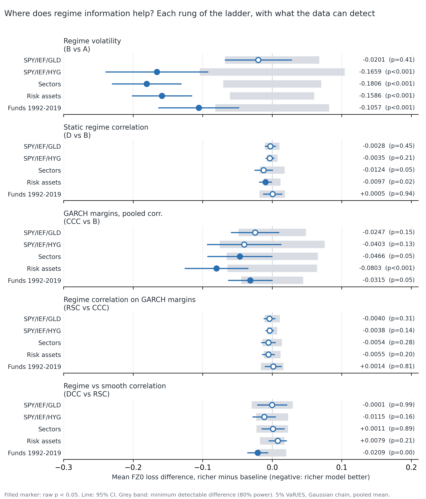

# Rough draft: methodology and results so far

**Regime-switching risk models for ETF portfolios.** Sanjeev, 27 October 2026. Rough draft for Prof. Seo's feedback.
Everything below is exploratory and uses data through 31 December 2019. The 2020-2025 period has not been used by any model.

## 1. At a glance

- **Question.** For a fixed diversified ETF portfolio, which of three ingredients improves one-day-ahead VaR/ES forecasts: regime-dependent volatility, volatility dynamics within a regime, or regime-dependent correlation?
- **Headline.** I find no detectable gain from letting correlations switch by regime. Most of the improvement comes from volatility modelling (regimes, then GARCH dynamics), and my design has limited power for correlation effects, which I report next to every result.
- **Done.** A pre-registered pilot; a broad exploration (10 ETF universes, 10 regime definitions, a 1992-2019 fund sample); a controlled model ladder; a replication; a power study with GARCH margins; a validated code base (62 tests); a methods chapter draft (attached as `01_design_and_methods.md`).
- **Not done.** The confirmatory test on 2020-2025 (waiting for your view on the design), a second data vendor, and the results chapters.
- **What I need from you.** Seven short answers, listed in section 8 (five decisions, two pieces of guidance).

## 2. Research question and design

I compare nested models, adding one ingredient at a time, on the same data and the same regime signal. Differences in loss between neighbouring models attribute an improvement to a single ingredient.

| Model | Description |
|---|---|
| A | Pooled normal, no regimes |
| B | Regime-specific volatilities, pooled correlation |
| D | Regime-specific volatilities and correlations |
| CCC | GARCH(1,1) margins, constant correlation |
| RSC | GARCH(1,1) margins, regime-switching correlation |
| DCC | DCC-GARCH benchmark (smoothly evolving correlation) |
| GARCH-t | Univariate GARCH-t on the portfolio return |

- **Regime signal.** One two-state Gaussian hidden Markov model fitted to SPY returns. Only filtered probabilities through day t-1 are used to forecast day t (no look-ahead; a unit test checks this).
- **Estimation.** Rolling 1,260-day window, regime model refit every 21 days, GARCH margins every 63 days.
- **Forecast and scoring.** VaR and ES at 5% and 2.5%, scored jointly with the FZ0 loss (Patton, Ziegel and Chen 2019). Models are compared with Diebold-Mariano tests with Newey-West errors. I report calibration (hit rates, Kupiec, Christoffersen) next to loss.
- **Portfolio.** Pilot: equal-weight SPY/IEF/GLD. Robustness universes: SPY/IEF/HYG, four sector ETFs, HYG/EEM/VNQ/DBC, and a 1992-2019 sample of mutual funds (VFINX/VUSTX) used as proxies.
- **Mean control.** An earlier comparison of GARCH-margin and static models also changed the mean treatment. I re-ran the static models with one pooled mean (and with zero mean) so the comparison isolates volatility.

## 3. Data and discipline

- Raw data are downloaded once and archived with SHA-256 hashes; nothing is re-pulled.
- Development and exploration use data through 2019 (2016-2019 doubles as a pseudo-holdout). **2020-2025, which contains the 2022 stock-bond correlation reversal, is an untouched confirmatory hold-out.** One caveat: the earlier descriptive EDA and data audit did display summary statistics for 2010-2025, so "untouched" means no specification was fitted or tuned there.
- Every specification tried is logged in `docs/decisions_log.md`, including unpromising ones. Test families were declared before scoring and adjusted with the Holm procedure.
- **A pre-declared bar I did not meet.** I declared that the GARCH-margin effect would count as established only if it was Holm-significant in at least two of four universes. It is negative in all four but Holm-significant in one (U10, adjusted p = 0.0025; the others 0.22 to 0.23). A separate replication on the 1992-2009 fund sample gave the same sign and size but p = 0.12. I therefore report this effect as **suggestive, not established**.

## 4. Results so far

### 4a. Pilot (SPY/IEF/GLD, 2010-2015)

All six pre-registered criteria passed (correctness; test size; detectability; regime stability; reproducibility; feasibility), two only marginally.

| Check | Result |
|---|---|
| False-positive rate of the correlation test (D vs B) | 5.0% (simulated, stylised process) |
| Power, strong correlation shift, 10 years | 52.5% (42.0% under a real-data-calibrated process) |
| Power, moderate shift | 25.5% |
| Regime stability across 72 refits | 90.3% pass (bar was 90%) |
| Real data, D vs B | t = -0.47, p = 0.64 |

### 4b. Exploration (214 headline tests across universes, regime definitions and two alpha levels)

- **Correlation switching (D vs B):** 37 of 214 tests have raw p < 0.05 (18 favour D, 19 favour B); **none survive Holm** (smallest adjusted p = 0.141).
- **Against benchmarks:** regime models beat the pooled normal in 105 of 214 comparisons (never significantly worse) but are **never significantly better than GARCH-t or DCC-t**, and are significantly worse in 96 and 124 of 214.
- **Where correlations move:** in diversified universes correlations fall in stress (Treasuries hedge more); only equity-heavy or risk-asset universes show rises.
- **The motivating regime is missing from the data:** positive 252-day stock-bond correlation on 90.6% of days in 1987-1999, 23.7% in 2000-2009 and 0% in 2010-2019 (fund proxies). All volatility-based regime definitions miss the 2013 taper tantrum.

### 4c. The ladder (5% VaR/ES, Gaussian components, pooled mean, full forecast window)

Mean FZ0 difference, richer minus baseline (negative: richer model better), with raw p in brackets. U1 = SPY/IEF/GLD, U3 = SPY/IEF/HYG, U8 = sectors, U10 = risk assets, Funds = VFINX/VUSTX 1992-2019.

| Step | U1 | U3 | U8 | U10 | Funds |
|---|---|---|---|---|---|
| Regime volatility (B vs A) | -0.020 (0.41) | -0.166 (<0.001) | -0.181 (<0.001) | -0.159 (<0.001) | -0.106 (<0.001) |
| GARCH margins (CCC vs B) | -0.025 (0.15) | -0.040 (0.13) | -0.047 (0.05) | -0.080 (<0.001) | -0.032 (0.05) |
| GARCH margins, primary test (RSC vs D) | -0.026 (0.14) | -0.041 (0.12) | -0.040 (0.07) | -0.076 (<0.001) | -0.031 (0.12) |
| Regime correlation on GARCH margins (RSC vs CCC) | -0.004 (0.31) | -0.004 (0.14) | -0.005 (0.28) | -0.006 (0.20) | +0.001 (0.81) |
| Minimum detectable difference, same step | 0.011 | 0.007 | 0.014 | 0.012 | 0.016 |

- **Volatility is where the improvement is.** Regime volatility is large in three of four universes. Adding GARCH dynamics improves the loss further, by 0.025 to 0.08 in every sample.
- **Correlation switching adds little.** On top of GARCH margins the effect is -0.004 to -0.006, about half of what the design could detect, with the same sign in four of five samples.
- **Calibration.** Static regime models are too conservative (5% hit rates 2.8% to 4.2%); the GARCH-margin models are close to 5% (4.3% to 5.5%).
- **The mean treatment does not explain the margin effect.** On the pilot universe it is -0.0259 with pooled means and -0.0263 with regime means.
- **Regime vs smooth correlation (DCC vs RSC)** is indistinguishable in four of five samples (the fund sample favours DCC, p = 0.004).

### 4d. Power study with GARCH margins (simulation, 200 replications per scenario, 2,520 test days)

| Step (one-sided 5% test) | Null | Moderate shift | Strong shift | Flight to quality |
|---|---|---|---|---|
| Regime vs constant correlation, all pairs | 4.5% | 22.5% | 38.0% | 3.5% |
| Same, only the SPY-IEF pair switches | 4.5% | 27.0% | 53.5% | 5.5% |
| Margin and volatility steps | 91-100% | 91-100% | 91-100% | 91-100% |

The correlation test has the right size but weak power for anything short of a large shift. The volatility and margin effects would be easy to detect if they were as large as in the simulation. The simulated shifts are concentrated in the SPY-IEF pair by construction, so the single-pair advantage may be overstated.

### 4e. Secondary leads (unadjusted, to be treated as hypotheses only)

- **Family test.** Hansen's SPA finds no regime model that beats GARCH-t or DCC-t in any of the five samples (p from 0.13 to 0.96).
- **Conditional test (Giacomini-White)** on the fund sample: regime correlation helps when the lagged stock-bond correlation is positive (mean loss difference -0.010) and slightly hurts otherwise (+0.008); joint p = 0.047. This is one of several secondary tests and the effect is absent in 1992-1999, so I treat it only as a hypothesis for the hold-out.

## 5. What I think the thesis is now

A controlled ablation plus a detectability analysis: where does regime information help tail-risk forecasts, and what could this data ever reveal? A headline that "correlation switching improves risk forecasts" is not supported by anything I have. That regime gains are larger against simple baselines is already known (Ardia et al. 2018, from my notes, abstract-level), so my contribution is the quantified decomposition in a multivariate setting together with power reported for each step.

## 6. Limitations

- The regime signal uses equity returns only and misses bond-led shocks (the 2013 taper tantrum).
- A fast volatility regime may be the wrong tool for the stock-bond correlation sign, which looks like a slow macro state.
- One equal-weight portfolio per universe; the universes share most of their data, so I do not pool across them.
- The benchmarks (GARCH-t, DCC) keep their own fitted means.
- Same data vendor for all ETF data (two downloads agree to within 2.5e-6 on daily returns, but that is not a second source); the 1992-2019 sample uses mutual funds as proxies.
- HMM estimation uncertainty is not carried into the Diebold-Mariano tests. The simulated null rejection rate (4.5%) is the only check on this.
- Simulation numbers describe the simulated process, not markets. The 2020-2025 hold-out has about 1,510 days, fewer than the 2,520 simulated, so its power will be lower than shown.

## 7. Next steps

1. Simulate power at the real hold-out length (about 1,510 days).
2. Freeze one confirmatory test and write it down before looking at 2020-2025. Proposed: single-pair (SPY-IEF) regime correlation versus constant correlation, on GARCH margins, 5% level. I chose it because it had equal size and higher simulated power.
3. Run it once on 2020-2025, with the 2022 episode, the conditional test, and the minimum detectable difference reported next to the result.
4. Write the full methods and results chapters.

## 8. Questions for you

**Decisions that unblock the next step**
1. Is the ladder-plus-detectability framing acceptable as the thesis?
2. Do you approve the single confirmatory test described in 7.2?
3. Do you approve the hold-out protocol (choices fixed on data through 2019, then freeze, then one run on 2020-2025)?
4. Is a second data vendor (for example CRSP) available through the university?
5. I dropped the allocation extension. Should the title be narrowed accordingly?

**Guidance I would value**
6. Is a thesis whose main result is a well-powered null (no detectable gain from correlation switching, with the power reported) acceptable, or would you steer me towards a design with a better chance of a positive result? And is a slow macro-state signal for the stock-bond correlation (for example inflation volatility) worth including, or better left as future work?
7. What milestones or deadlines would you like from me from here, and in what form do you want the next update?

*Attached with this draft: `01_design_and_methods.md`, a first draft of the methods chapter.*

## Glossary

- **VaR / ES:** the loss exceeded with probability alpha / the average loss in that tail.
- **FZ0:** a scoring rule that evaluates VaR and ES together; lower is better.
- **DM test:** Diebold-Mariano test of whether two models' average losses differ.
- **Holm:** a correction for testing many hypotheses at once.
- **HMM:** hidden Markov model; infers each day's probability of being in a calm or stress regime.
- **CCC / DCC:** constant / dynamic conditional correlation GARCH models.
- **Minimum detectable difference:** the smallest loss difference the test would detect 80% of the time.
