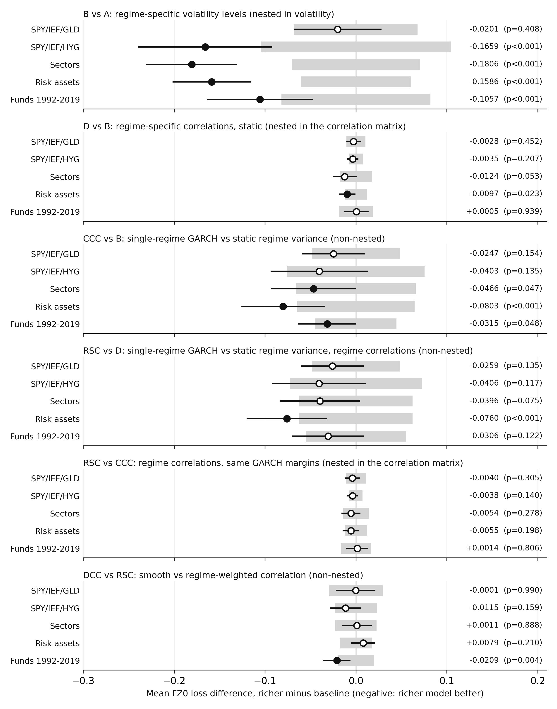

# Rough draft: methodology and results so far (corrected)

**Regime-switching risk models for ETF portfolios.** Sanjeev, corrected 3 November 2026. This replaces the draft of 27 October 2026; `notes/outbox/01_correction_note.md` lists the corrections.
Everything below is exploratory and uses data through 31 December 2019. The 2020-2025 period has not been used by any model.

## 1. At a glance

- **Question.** For a fixed diversified ETF portfolio, how do one-day-ahead VaR/ES forecasts change with regime-dependent volatility, with a single-regime GARCH(1,1) volatility model, and with regime-dependent correlation, and how large a change could this data reveal?
- **Headline.** I do not detect an improvement from letting correlations switch by regime on GARCH margins: the estimates are -0.004 to -0.006 on the ETF universes, and the design could detect about 0.007 to 0.014. This is inconclusive for smaller effects. The larger estimated differences come from the volatility comparisons, and my design has limited power for correlation effects, which I report next to every result.
- **Done.** A pre-registered pilot; a broad exploration (10 ETF universes, 10 regime definitions, a 1992-2019 fund sample); a sequence of model comparisons; a further check on the fund sample; a power study with GARCH margins; a validated code base (62 tests); a methods chapter draft (attached as `01_design_and_methods.md`).
- **Not done.** The confirmatory test on 2020-2025, a second data vendor, and the results chapters.

## 2. Research question and design

I compare a sequence of models that share data, regime signal and estimation window. Two comparisons (D vs B, RSC vs CCC) differ in the correlation matrix only; others also differ in how volatility is modelled and are interpreted as comparisons between model classes.

| Model | Description | Compared with |
|---|---|---|
| A | Pooled normal, no regimes | reference |
| B | Regime-specific volatilities, pooled correlation | A (nested in volatility) |
| D | Regime-specific volatilities and correlations | B (nested in the correlation matrix) |
| CCC | GARCH(1,1) margins with no regime dependence, constant correlation | B (non-nested) |
| RSC | GARCH(1,1) margins with no regime dependence, regime-switching correlation | CCC (correlation matrix only); D (non-nested) |
| DCC | DCC-GARCH benchmark (smoothly evolving correlation) | RSC (non-nested) |
| GARCH-t | Univariate GARCH-t on the portfolio return | DCC (non-nested) |

- **Regime signal.** One two-state Gaussian hidden Markov model fitted to SPY returns. Regime moments in each window are weighted by smoothed in-window probabilities (data up to the window end only). Forecast-day mixture weights are filtered probabilities propagated one step (no look-ahead; a unit test checks this).
- **Estimation.** Rolling 1,260-day window, regime model refit every 21 days, GARCH margins every 63 days.
- **Forecast and scoring.** VaR and ES at tail levels 5% and 2.5%, scored jointly with the FZ0 loss (Patton, Ziegel and Chen 2019). Models are compared with Diebold-Mariano statistics using a Bartlett kernel with lag floor(4(T/100)^(2/9)). I report calibration (hit rates, Kupiec, Christoffersen) next to loss.
- **Portfolio.** Pilot: SPY/IEF/GLD with constant weights of 1/3 each, rebalanced daily. Further universes: SPY/IEF/HYG, four sector ETFs, HYG/EEM/VNQ/DBC, and a 1992-2019 sample of mutual funds (VFINX/VUSTX) used as proxies.
- **Mean control.** An earlier comparison of GARCH-margin and static models also changed the mean treatment. I re-ran the static models with one pooled mean (and with zero mean) so the comparison does not depend on regime-specific means.

## 3. Data and discipline

- Raw data are downloaded once and archived with SHA-256 hashes; nothing is re-pulled.
- Development and exploration use data through 2019. The years 2016-2019 are a dry-run window, not independent validation, because the specifications were chosen after seeing 2010-2019 results. **2020-2025, which contains the 2022 stock-bond correlation reversal, is the confirmatory hold-out.** One caveat: the earlier descriptive EDA and data audit displayed summary statistics for 2010-2025, so "held out" means no specification was fitted or tuned there.
- Every specification tried is logged in `docs/decisions_log.md`, including unpromising ones. Test families were declared before scoring and adjusted with the Holm procedure.
- **A pre-declared bar I did not meet.** I declared that the GARCH-margin comparison would count as established only if it was Holm-significant in at least two of four universes. It is negative in all four but Holm-significant in one (U10, adjusted p = 0.0025; the others 0.22 to 0.23). A separate test on the full 1992-2019 fund sample (n = 7,053), whose 2010-2019 part overlaps the ETF samples in time, gave the same sign and similar size but a two-sided p = 0.12. I therefore report this comparison as **suggestive, not established**.

## 4. Results so far

### 4a. Pilot (SPY/IEF/GLD, 2010-2015)

All six pre-registered criteria passed (correctness; test size; detectability; regime stability; reproducibility; feasibility), two only marginally.

| Check | Result |
|---|---|
| False-positive rate of the correlation test (D vs B) | 5.0% (simulated, stylised process without GARCH margins; see 4d for the GARCH process) |
| Power, strong correlation shift, 10 years | 52.5% (42.0% under a real-data-calibrated process) |
| Power, moderate shift | 25.5% |
| Regime stability across 72 refits | 90.3% pass (bar was 90%) |
| Real data, D vs B | t = -0.47, two-sided p = 0.64 |

### 4b. Exploration (214 headline tests across universes, regime definitions and two tail levels)

- **Correlation switching (D vs B):** 37 of 214 tests have raw two-sided p < 0.05 (18 favour D, 19 favour B); **none survive Holm** (smallest adjusted p = 0.141). The raw count is not evidence of an effect: under the GARCH-margin process with no correlation change, this test rejects at |t| > 1.96 in 17.0% of replications (section 4d), close to the 17.3% seen here.
- **Against benchmarks:** D has significantly lower loss than the pooled normal in 105 of 214 comparisons (never significantly higher) but is **never significantly better than GARCH-t or DCC-t**, and is significantly worse in 96 and 124 of 214.
- **Where correlations move:** in diversified universes correlations fall in stress (Treasuries hedge more); only equity-heavy or risk-asset universes show rises.
- **The motivating regime is absent from the development data:** positive 252-day stock-bond correlation on 90.6% of days in 1987-1999, 23.7% in 2000-2009 and 0% in 2010-2019 (fund proxies). All volatility-based regime definitions miss the 2013 taper tantrum.

### 4c. Model comparisons (tail level 5%, Gaussian components, pooled mean, full forecast window)

Mean FZ0 difference, richer minus baseline (negative: richer model better), with raw two-sided p in brackets. U1 = SPY/IEF/GLD, U3 = SPY/IEF/HYG, U8 = sectors, U10 = risk assets, Funds = VFINX/VUSTX 1992-2019.

| Comparison | U1 | U3 | U8 | U10 | Funds |
|---|---|---|---|---|---|
| Regime volatility (B vs A) | -0.020 (0.41) | -0.166 (<0.001) | -0.181 (<0.001) | -0.159 (<0.001) | -0.106 (<0.001) |
| Single-regime GARCH vs static regime variance (CCC vs B) | -0.025 (0.15) | -0.040 (0.13) | -0.047 (0.05) | -0.080 (<0.001) | -0.032 (0.05) |
| Same, primary test (RSC vs D) | -0.026 (0.14) | -0.041 (0.12) | -0.040 (0.07) | -0.076 (<0.001) | -0.031 (0.12) |
| Regime correlation on GARCH margins (RSC vs CCC) | -0.004 (0.31) | -0.004 (0.14) | -0.005 (0.28) | -0.006 (0.20) | +0.001 (0.81) |
| Minimum detectable difference, same comparison (two-sided 5%, 80% power) | 0.011 | 0.007 | 0.014 | 0.012 | 0.016 |

- **Volatility comparisons.** Regime volatility lowers loss by a large amount in three of four universes against a pooled normal. A single-regime GARCH(1,1) model class has lower loss than static regime covariance, by 0.025 to 0.08 in every sample. This also changes the correlation input, the mean estimator and the mixture, so it is a comparison between model classes.
- **Correlation switching.** On GARCH margins the estimated effects are -0.004 to -0.006 on the ETF universes, between a third and a half of the minimum detectable difference (0.36, 0.52, 0.39, 0.46 for U1, U3, U8, U10; the 95% interval is the inference), and +0.001 on the fund sample.
- **Calibration.** Static regime models have hit rates below 5% on the four ETF universes (A 2.8-3.4%, B 2.8-4.2%, D 3.0-4.0%), but not on the fund sample (B 5.4%, D 5.3%). The GARCH-margin models are close to 5% (4.3% to 5.5%).
- **The mean treatment affects the size of the volatility comparison, not its sign.** RSC vs D on the pilot universe is -0.0259 with pooled means, -0.0263 with regime means and -0.0339 with zero means (U3 -0.0569, U8 -0.0504, U10 -0.0814 with zero means). With zero means the RSC-vs-CCC estimate is about 0.000 on U1 and U3, against -0.004 with pooled means.
- **Regime vs smooth correlation (DCC vs RSC).** No significant difference in the four ETF universes (two-sided p 0.16 to 0.99; the minimum detectable difference is 0.018 to 0.030). The fund sample favours DCC (-0.021, two-sided p = 0.004).
- **The real-data single-pair row.** RSC_P vs CCC on U1, 2010-2019: -0.0015, two-sided p = 0.14, minimum detectable difference 0.0028 (SE about 0.0010).

### 4d. Power study with GARCH margins (simulation, 200 replications per scenario, 2,520 test days)

| Comparison (rejection rate, one-sided 5% test, tail level 5%) | Null | Moderate shift | Strong shift | Flight to quality |
|---|---|---|---|---|
| Regime vs constant correlation, all pairs | 4.5% | 22.5% | 38.0% | 3.5% |
| Same, only the SPY-IEF pair switches | 4.5% | 27.0% | 53.5% | 5.5% |
| Static correlation step (D vs B) | **11.0%** | 31.0% | 45.5% | 5.5% |
| Margin and volatility comparisons | 91-95.5% | 93.5-99.5% | 96-99.5% | 91-93% |

The correlation test on GARCH margins has a one-sided rejection rate of 4.5% under the null (95% CI 1.6-7.4) but weak power for anything short of a large shift. In the other direction it rejects "richer worse" at t > +1.645 in 8.0% of null replications. The static D-vs-B test is oversized under GARCH margins (11.0%, 95% CI 6.7-15.3), which the pilot's 5.0% on a process without GARCH did not show. The volatility and margin comparisons would be easy to detect if they were as large as in the simulation. The simulated shifts are concentrated in the SPY-IEF pair by construction, so the single-pair advantage may be overstated.

### 4e. Secondary leads (unadjusted, to be treated as hypotheses only)

- **Family test.** Hansen's SPA finds no regime model that beats GARCH-t or DCC-t in any of the five samples (consistent p from 0.13 to 0.96).
- **Conditional test (Giacomini-White)** on the fund sample: regime correlation has lower loss when the lagged stock-bond correlation is positive (mean loss difference -0.010) and slightly higher loss otherwise (+0.008); joint p = 0.047. This is one of several secondary tests and the pattern is absent in 1992-1999, so I treat it only as a hypothesis for the hold-out.

## 5. What I think the thesis is now

A sequence of comparisons plus a detectability analysis: where does regime information change tail-risk forecasts, and what could this data ever reveal? A headline that "correlation switching improves risk forecasts" is not supported by anything I have. My contribution is the quantified comparison in a multivariate setting together with power reported for each step.

## 6. Limitations

- The regime signal uses equity returns only and misses bond-led shocks (the 2013 taper tantrum).
- A fast volatility regime may be the wrong tool for the stock-bond correlation sign, which may move more slowly (the literature on this is being checked).
- One equal-weight portfolio per universe; the universes share most of their data, so I do not pool across them.
- The benchmarks (GARCH-t, DCC) keep their own fitted means.
- Same data vendor for all ETF data (two downloads agree closely on daily returns through 2019, but that is not a second source); the 1992-2019 sample uses mutual funds as proxies.
- HMM estimation uncertainty is not carried into the Diebold-Mariano tests. The simulated null rejection rate (4.5%) is the only check on this.
- Simulation numbers describe the simulated process, not markets. The 2020-2025 hold-out has 1,508 forecast days, fewer than the 2,520 simulated, so its power will be lower than shown; a simulation at 1,508 days is being run.

## 7. Next steps

1. Simulate power at the real hold-out length (1,508 days).
2. Freeze one confirmatory test and write it down before looking at 2020-2025: single-pair (SPY-IEF) regime correlation versus constant correlation, on GARCH margins, tail level 5%, one-sided test at 5%, with the two-sided 95% interval always reported. I chose this test because it had equal size and higher simulated power on a process in which the shift is largest in that pair by construction; the pair was fixed in advance by the stock-bond hypothesis.
3. Run it once on 2020-2025, with the 2022 episode, the conditional test, and the minimum detectable difference reported next to the result.
4. Write the full methods and results chapters.

## Glossary

- **VaR / ES:** the loss exceeded with probability alpha / the average loss in that tail.
- **FZ0:** a scoring rule that evaluates VaR and ES together; lower is better.
- **DM test:** Diebold-Mariano test of whether two models' average losses differ.
- **Holm:** a correction for testing many hypotheses at once.
- **HMM:** hidden Markov model; infers each day's probability of being in a calm or stress regime.
- **CCC / DCC:** constant / dynamic conditional correlation GARCH models.
- **Minimum detectable difference:** the smallest loss difference the test would detect 80% of the time.
